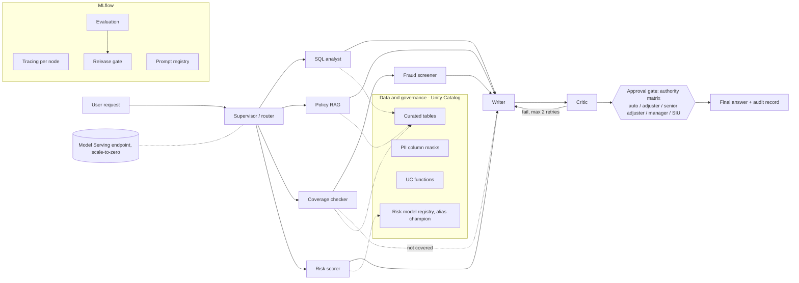

# Multi-agent claims and underwriting automation on Databricks

A LangGraph multi-agent system for insurance claims and underwriting questions, built on Databricks Free Edition with MLflow tracing and evaluation and Unity Catalog governance. It is deployed as a scale-to-zero Model Serving endpoint. All data is synthetic or a public toy dataset.

## What and why

A claims team spends its time deciding which claims are routine, which need an adjuster, which need a senior sign-off, which go to the special investigation unit (SIU), and then proving afterwards why that call was made. I built a copilot for that workflow where the language model is kept away from the decisions. Code decides coverage, payable amount, fraud referral, risk band and who must approve. The model only routes the question and puts the structured result into words. Every decision above the auto-settle limit pauses for a named human role, every node is traced, and a release is blocked if the evaluation shows a regression.

## Architecture



The diagram above is Mermaid so GitHub renders it. A rendered image (prompt in `docs/DIAGRAM_PROMPT.md`) can replace it. Claim questions go through the coverage checker first; the fraud screener and risk scorer run only when the claim is covered. The UC functions in `agent_tools` can be exposed through Managed MCP, but the graph reads the warehouse over SQL and does not consume MCP.

## Results

Held-out split: 31 items, 3 runs each (93 graph runs), never used to tune prompts, code or scorers. Mean over runs per item, then a 95% t-interval across items. Source: `docs/EVALUATION.md`, `eval/results/report_heldout_v1.json`.

| Metric | Mean | 95% interval |
|---|---|---|
| Route accuracy | 0.968 | 0.902 to 1.000 |
| Tool trajectory | 0.968 | 0.902 to 1.000 |
| Citation validity | 0.968 | 0.902 to 1.000 |
| SQL result match | 0.968 | 0.902 to 1.000 |
| Safety (injection cases) | 1.000 | 1.000 to 1.000 |
| Authority-matrix routing | 1.000 | 1.000 to 1.000 |
| Fraud-referral match | 1.000 | 1.000 to 1.000 |
| Groundedness (LLM judge) | 0.944 | 0.898 to 0.989 |
| Correctness (LLM judge) | 0.887 | 0.793 to 0.981 |

Operational, held-out: median notional cost per request about 0.0004 USD, p95 latency 12.3 s, straight-through-processing rate 0.31, critic escalation rate 0.

Risk model (registered as `risk_classifier`, alias `champion`): holdout AUC 0.888; disparate impact ratio sex 0.937, region 0.865 (both pass the four-fifths rule; sex is not a feature).

Honesty notes:

- The judge scores (groundedness, correctness) are not calibrated against human labels. The 30-row sheet is at `eval/calibration_to_label.csv` and has not been labelled, so no kappa exists. Treat judge numbers as indicative.
- Fraud precision and recall of 1.0 over 21 positive cases are partly circular: the expected referral was produced by running the same deterministic screener on the same data. They show the graph passes the screener's verdict through correctly, not that it catches real fraud.
- The golden set has 77 items (46 dev, 31 held-out). The dev split was used to find and fix problems, so its numbers (route accuracy 1.000 and groundedness 0.978 in the final dev run) are optimistic. The held-out table is the honest one.
- 31 items give wide intervals. 0.97 versus 1.00 is not a difference this evaluation can resolve.
- Known held-out failures left unfixed: a supervisor refusal of a legitimate policy question in one of three runs (`policy-14`), a reference rounded to 39.4 against a correct 39.39 (`analytics-09`), judge noise (`risk-04`), and groundedness 0.5 on a refusal (`refuse-02`).

## What is distinctive

- **Deterministic decisions, LLM for routing and wording.** Coverage, payable amount, fraud flags, risk band and required authority come from tested code ([ADR-005](docs/adr/005-deterministic-decisions-llm-wording.md)). A question that names a claim id always goes to the decision pipeline by pattern match, without relying on the router.
- **Authority matrix and human gate.** Required approver is a pure function of payable amount and fraud result: auto under 2,000, adjuster, senior adjuster, manager, SIU for any referral. The graph pauses at a LangGraph interrupt; the reply is `approve`, `reject` or `edit` with the run id. A replayed or unknown run id takes no action.
- **Explainable fraud flags that never auto-deny.** Six rules, each with evidence. A referral changes the required approver to SIU; a person decides.
- **Fairness audit with sex excluded.** Disparate impact ratios are logged at training time ([docs/GOVERNANCE.md](docs/GOVERNANCE.md)).
- **Evaluation-gated release with two challenger experiments.** On the dev split, a supervisor told to "refuse if not completely certain" moved route accuracy from 1.000 to 0.978 and the gate passed (inside the noise). A writer told to answer in at most eight words moved correctness from 0.951 to 0.674 and groundedness from 0.978 to 0.788, and the gate failed with named reasons.
- **Injection handling.** A guarded SQL path (single read-only SELECT on curated tables), a critic that fails any draft granting a claim when notes or policy text contain an injected instruction, and 3 injection cases in the golden set (safety 1.000 held-out). This is a small set, not a red-team suite.
- **Notional cost per request.** A per-node token ledger priced from a table written from memory; see [docs/COST_ANALYSIS.md](docs/COST_ANALYSIS.md).

## Try it

The endpoint is `agents_insurance_automation-models-claims_copilot_agent` (model version 3). It scales to zero, so the first call after idle can be slow. Calls need a Databricks profile with access to that workspace (`DATABRICKS_CONFIG_PROFILE`).

```
python -m scripts.query_endpoint "How late can a claim be reported before it needs a documented reason?"
python -m scripts.query_endpoint "Please decide claim C00009"
```

Under the hood this is:

```
databricks api post /serving-endpoints/agents_insurance_automation-models-claims_copilot_agent/invocations \
  --json '{"input": [{"role": "user", "content": "Please decide claim C00009"}]}' --profile <profile>
```

The second question pauses for a senior adjuster and returns a run id; reply `approve <run id>` as a follow-up question. Real captured responses, including the approval, the replay refusal, an injection and an out-of-scope request, are in [docs/endpoint_samples.md](docs/endpoint_samples.md).

## Quickstart

Install, authenticate, set the warehouse id and run the scripts in order: see [docs/SETUP.md](docs/SETUP.md). The unit tests (about 244) run offline with `pytest -q`.

## Repository map

| Path | Contents |
|---|---|
| `src/insurance_automation/agents/` | LangGraph nodes, state, approval gate, serving wrapper |
| `src/insurance_automation/tools/` | SQL guard, retrieval, coverage, fraud, authority, risk |
| `src/insurance_automation/llm/` | Model client, response cache, cost ledger |
| `src/insurance_automation/evaluation/` | Scorers, judges, harness, statistics, gate, calibration |
| `scripts/` | One script per lifecycle step |
| `eval/` | Golden set, calibration sheet, committed reports in `eval/results/` |
| `docs/` | [ARCHITECTURE](docs/ARCHITECTURE.md), [EVALUATION](docs/EVALUATION.md), [GOVERNANCE](docs/GOVERNANCE.md), [COST_ANALYSIS](docs/COST_ANALYSIS.md), [SETUP](docs/SETUP.md), [PRD](docs/product/PRD.md), [ADRs](docs/adr/) |

## Done vs roadmap

Done: supervisor graph with five specialist paths, writer, critic and approval gate; Unity Catalog tables, column masks and functions; registered risk model with fairness audit; prompt registry; per-node tracing; custom evaluation harness with confidence intervals; release gate with two challenger experiments; deployed serving endpoint.

Not built: multi-turn simulated users, a full red-team set, hybrid retrieval and reranking (retrieval is TF-IDF), model routing, agent memory, a feedback flywheel, online scoring on production traces, calibrated judges (pending hand labels), and MCP consumption by the graph.

## Limitations

- Data is synthetic or a public toy dataset; fraud labels are seeded (about 8 percent). This is not a validated pricing model.
- Judge scores are uncalibrated; fraud precision and recall are partly circular; the held-out set is small.
- Pending approvals live in the endpoint process memory and are lost on restart or scale-to-zero. Decisions already made persist in the log table.
- The authorised role named in an approval reply is not authenticated on Free Edition: anyone who can call the endpoint and knows a run id can reply as that role.
- Audit-table writes are best-effort.
- Cost figures are notional, from a price table written from memory and not verified. Free Edition does not bill per token.
- Run-to-run variation comes from the LLM even at temperature 0.

## Licence

MIT. See [LICENSE](LICENSE).
