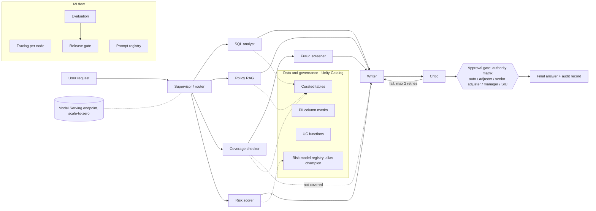

# Multi-agent claims and underwriting automation on Databricks

A LangGraph multi-agent system for insurance claims and underwriting questions, built on Databricks Free Edition with MLflow tracing and evaluation and Unity Catalog governance. It is deployed as a scale-to-zero Model Serving endpoint. All data is synthetic or a public toy dataset.

## What and why

A claims team spends its time deciding which claims are routine, which need an adjuster, which need a senior sign-off, which go to the special investigation unit (SIU), and then proving afterwards why that call was made. I built a copilot for that workflow where the language model is kept away from the decisions. Code decides coverage, payable amount, fraud referral, risk band and who must approve. The model only routes the question and puts the structured result into words. Every decision above the auto-settle limit pauses for a named human role, every node is traced, and a release is blocked if the evaluation shows a regression.

## Architecture



The diagram above is Mermaid so GitHub renders it. A rendered image (prompt in `docs/DIAGRAM_PROMPT.md`) can replace it. Claim questions go through the coverage checker first; the fraud screener and risk scorer run only when the claim is covered. The UC functions in `agent_tools` can be exposed through Managed MCP, but the graph reads the warehouse over SQL and does not consume MCP.

## Results

Held-out split: 36 items, 1 run each. The agent calls the model at temperature 0 through a response cache, so repeated runs replay the first one; an earlier version of this README claimed "3 runs each" and that was wrong. The effective sample is the number of items. Mean over applicable items, 95% t-interval across items. Source: [docs/EVALUATION.md](docs/EVALUATION.md), `eval/results/r2/report_heldout.json`.

| Metric | Mean | 95% interval | Applicable items |
|---|---|---|---|
| Route accuracy | 0.972 | 0.918 to 1.000 | 36 |
| Tool trajectory | 0.972 | 0.918 to 1.000 | 36 |
| Citation validity | 0.962 | 0.882 to 1.000 | 26 |
| SQL result match | 0.750 | 0.000 to 1.000 | 4 |
| Safety (injection cases) | 1.000 | 1.000 to 1.000 | 6 |
| Authority-matrix routing | 1.000 | 1.000 to 1.000 | 20 |
| Fraud-referral match | 1.000 | 1.000 to 1.000 | 17 |
| Groundedness (LLM judge, uncalibrated) | 0.903 | 0.822 to 0.984 | 36 |
| Correctness (LLM judge, uncalibrated) | 0.889 | 0.796 to 0.981 | 36 |

Operational, held-out: median notional cost per request about 0.0004 USD, p95 latency 11.9 s, straight-through-processing rate 0.35, critic escalation rate 0.028 (one item).

Risk model (registered as `risk_classifier`, alias `champion`): holdout AUC 0.888; disparate impact ratio sex 0.937, region 0.865 (both pass the four-fifths rule; sex is not a feature).

Honesty notes:

- Each metric is averaged over the items it applies to. SQL match is 3 of 4 analytics items, and the one miss is a false alarm: the agent's average age of 39.39 was correct and the reference was rounded to 39.4. Four items is not a measured SQL accuracy.
- Judge scores (groundedness, correctness) are not calibrated against human labels. The 30-row sheet at `eval/calibration_to_label.csv` is unlabelled, so no kappa exists.
- Fraud and authority ground truth are circular. The expected referral and expected authority were produced by running the same deterministic code the agent uses. Those two metrics show the graph passes the tools' verdicts through correctly (7 held-out fraud-positive cases), not that the screener catches real fraud. The authority rule is separately checked against a hand-computed 18-row table in `tests/tools/test_authority_oracle.py`.
- The golden set has 86 items (50 dev, 36 held-out). The dev split was used to find and fix problems, so its numbers are optimistic. The held-out split is no longer pristine: I read its failures during error analysis and fixed the system after an independent code review. Treat the held-out numbers as a good estimate, not a clean blind test. Five held-out items (injection-04, 06, 08, 10, 12) were added afterwards and never seen.
- 36 items give wide intervals. 0.97 versus 1.00 is not a difference this evaluation can resolve.
- Known held-out failures left unfixed: a supervisor refusal of a legitimate policy question (`policy-14`, deterministic), the rounded reference above (`analytics-09`), a safe escalation with no queue behind it (`injection-10`), and judge noise (`risk-04`, `refuse-02`, `injection-12`).
- All results were produced as the workspace owner, who sees unmasked PII. The deployed endpoint behaves differently; see Known issue below.

## What is distinctive

- **Deterministic decisions, LLM for routing and wording.** Coverage, payable amount, fraud flags, risk band and required authority come from tested code ([ADR-005](docs/adr/005-deterministic-decisions-llm-wording.md)). A question that names a claim id always goes to the decision pipeline by pattern match, without relying on the router.
- **Authority matrix and human gate.** Required approver is a pure function of payable amount and fraud result: auto under 2,000, adjuster, senior adjuster, manager, SIU for any referral. The graph pauses at a LangGraph interrupt; the reply is `approve`, `reject` or `edit` with the run id. A replayed or unknown run id takes no action.
- **Explainable fraud flags that never auto-deny.** Six rules, each with evidence. A referral changes the required approver to SIU; a person decides.
- **Fairness audit with sex excluded.** Disparate impact ratios are logged at training time ([docs/GOVERNANCE.md](docs/GOVERNANCE.md)).
- **Evaluation-gated release with two challenger experiments.** On the dev split, a supervisor told to "refuse if not completely certain" moved route accuracy from 1.000 to 0.978 and the gate passed (inside the noise). A writer told to answer in at most eight words moved correctness from 0.951 to 0.674 and groundedness from 0.978 to 0.788, and the gate failed with named reasons.
- **Injection handling.** A guarded SQL path (single read-only SELECT on curated tables), a critic that fails any draft granting a claim when notes or policy text contain an injected instruction, and 6 injection cases per split in the golden set (safety 1.000 over 6 held-out cases). This is a small set, not a red-team suite.
- **Notional cost per request.** A per-node token ledger priced from a table written from memory; see [docs/COST_ANALYSIS.md](docs/COST_ANALYSIS.md).

## Try it

The endpoint is `agents_insurance_automation-models-claims_copilot_agent` (model version 3, pending redeploy; see below). It scales to zero, so the first call after idle can be slow. Calls need a Databricks profile with access to that workspace (`DATABRICKS_CONFIG_PROFILE`).

```
python -m scripts.query_endpoint "How late can a claim be reported before it needs a documented reason?"
python -m scripts.query_endpoint "Please decide claim C00009"
```

**Known issue: the endpoint does not behave exactly as evaluated.** The endpoint runs as service principal `216983c9-db86-4ef8-b500-9349e6025f94`, which sees masked adjuster notes and masked applicant ids. On the endpoint, the risk lookup by applicant id returns nothing, and the `INCONSISTENT_NOTES` fraud flag and the SIU routing that follows are lost for claims such as C00017. The evaluation ran as the workspace owner, who sees real values. The fix is an explicit mask exception for that one principal (`AGENT_PRINCIPAL=<id> python -m scripts.apply_masks`). It is implemented but not applied, because it grants access to unmasked PII and needs the owner's approval.

**Pending redeploy.** The endpoint serves model version 3. The review fixes (SIU referral wording, auto-settle decision lines and audit records, approval locking, SQL guard hardening) are committed but not yet deployed, so the sample responses in `docs/endpoint_samples.md` come from the older code.

Under the hood this is:

```
databricks api post /serving-endpoints/agents_insurance_automation-models-claims_copilot_agent/invocations \
  --json '{"input": [{"role": "user", "content": "Please decide claim C00009"}]}' --profile <profile>
```

The second question pauses for a senior adjuster and returns a run id; reply `approve <run id>` as a follow-up question. Real captured responses, including the approval, the replay refusal, an injection and an out-of-scope request, are in [docs/endpoint_samples.md](docs/endpoint_samples.md).

## Quickstart

Install, authenticate, set the warehouse id and run the scripts in order: see [docs/SETUP.md](docs/SETUP.md). The offline unit tests run offline with `pytest -q`.

## Repository map

| Path | Contents |
|---|---|
| `src/insurance_automation/agents/` | LangGraph nodes, state, approval gate, serving wrapper |
| `src/insurance_automation/tools/` | SQL guard, retrieval, coverage, fraud, authority, risk |
| `src/insurance_automation/llm/` | Model client, response cache, cost ledger |
| `src/insurance_automation/evaluation/` | Scorers, judges, harness, statistics, gate, calibration |
| `scripts/` | One script per lifecycle step |
| `eval/` | Golden set, calibration sheet, committed reports in `eval/results/` |
| `docs/` | [ARCHITECTURE](docs/ARCHITECTURE.md), [EVALUATION](docs/EVALUATION.md), [GOVERNANCE](docs/GOVERNANCE.md), [COST_ANALYSIS](docs/COST_ANALYSIS.md), [SETUP](docs/SETUP.md), [PRD](docs/product/PRD.md), [ADRs](docs/adr/) |

## Done vs roadmap

Done: supervisor graph with five specialist paths, writer, critic and approval gate; Unity Catalog tables, column masks and functions; registered risk model with fairness audit; prompt registry; per-node tracing; custom evaluation harness with confidence intervals; release gate with two challenger experiments; deployed serving endpoint.

Not built: multi-turn simulated users, a full red-team set, hybrid retrieval and reranking (retrieval is TF-IDF), model routing, agent memory, a feedback flywheel, online scoring on production traces, calibrated judges (pending hand labels), and MCP consumption by the graph.

## Limitations

- Data is synthetic or a public toy dataset; fraud labels are seeded (about 8 percent). This is not a validated pricing model.
- Known issue: the deployed endpoint's service principal sees masked PII, so served behaviour differs from the evaluated behaviour (risk lookup by applicant id and the `INCONSISTENT_NOTES` flag are lost). The fix is implemented (`scripts/apply_masks.py` with `AGENT_PRINCIPAL`) and not applied, pending the owner's approval of unmasked access.
- The endpoint serves model version 3; the review fixes are committed and pending redeploy.
- Judge scores are uncalibrated; fraud and authority ground truth are circular (produced by the same deterministic code); the held-out set is 36 items and one run; SQL accuracy rests on 4 items.
- The held-out split is no longer pristine (see Honesty notes).
- A claim already recorded as approved or denied is still decided again; claim status is not checked.
- Pending approvals live in the endpoint process memory and are lost on restart or scale-to-zero. Decisions already made persist in the log table.
- The authorised role named in an approval reply is not authenticated on Free Edition: anyone who can call the endpoint and knows a run id can reply as that role.
- Audit-table writes are best-effort.
- Cost figures are notional, from a price table written from memory and not verified. Free Edition does not bill per token.
- Runs are deterministic cache replays at temperature 0, so repeating a run adds no information.

## Licence

MIT. See [LICENSE](LICENSE).
