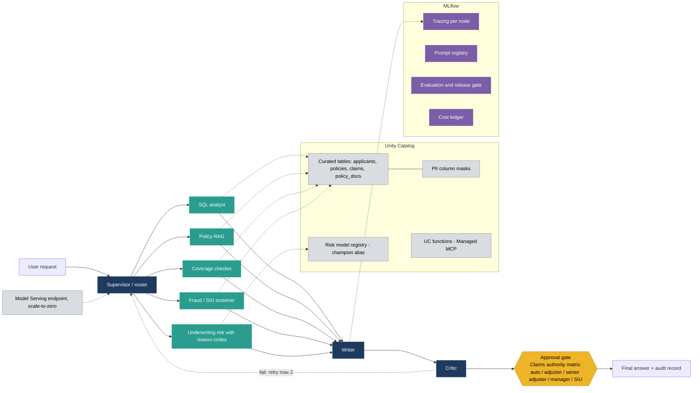

# Architecture diagram prompt (Google Gemini image generation)

Paste the block below into Gemini in one go. If the result is cluttered, send the refinement prompts afterwards. A Mermaid fallback is at the end.

```text
Create a clean architectural flowchart diagram.

VISUAL STYLE: white or very light grey background, flat vector look, rounded rectangles, one consistent muted palette: navy for orchestration, teal for agents, amber for human approval, grey for data and governance, purple for MLflow and observability. Thin directional arrows, readable labels, generous spacing, landscape 16:9. No photographic elements, no decorative clip art, no icons of people, no shadows or gradients. Spell all text exactly as given below.

TITLE (top, left aligned): "Multi-agent claims automation on Databricks: LangGraph + MLflow + Unity Catalog"

LAYOUT, left to right:
1. Small white box with navy outline: "User request". Arrow to:
2. Navy rounded rectangle: "Supervisor / router". Arrows fan out to a column of five teal rounded rectangles (the specialist agents), stacked vertically, top to bottom:
   - "SQL analyst"
   - "Policy RAG"
   - "Coverage checker"
   - "Fraud / SIU screener"
   - "Underwriting risk with reason codes"
3. Arrows from all five agents converge into one navy rounded rectangle: "Writer".
4. Arrow to a navy rounded rectangle: "Critic". From Critic, a curved loop-back arrow returns to the agent column, labelled "fail: retry max 2".
5. Arrow from Critic to a prominent AMBER rounded rectangle: "Approval gate" with the sub-label "Claims authority matrix: auto / adjuster / senior adjuster / manager / SIU".
6. Arrow from the Approval gate to a white box with navy outline: "Final answer + audit record".

GREY BAND (below the agent column, spanning under the agents): titled "Unity Catalog", containing four short items in a row: "Curated tables (applicants, policies, claims, policy_docs)", "PII column masks", "UC functions (Managed MCP)", "Risk model registry (champion alias)". Thin dotted lines connect the band up to the agents that use it.

PURPLE BAND (across the full bottom of the diagram): titled "MLflow", containing four items in a row: "Tracing per node", "Prompt registry", "Evaluation (6 layers) and release gate", "Cost ledger".

FAR RIGHT: a small grey rounded box: "Model Serving endpoint (scale-to-zero)", with a thin dotted line to the Supervisor / router group indicating that the whole graph is served from it.

LEGEND (bottom right, small): colour swatches with labels: navy "Orchestration", teal "Agents", amber "Human approval", grey "Data and governance", purple "MLflow / observability".

Keep arrows thin and avoid crossings where possible. Do not add any text that is not listed above.
```

## Refinement prompts (send after the first result)

1. Reduce the text size and increase spacing between all boxes. Keep every label exactly as written, and make sure nothing overlaps or is cut off.
2. Make all arrows orthogonal (right angles only), avoid arrow crossings, and route the "fail: retry max 2" loop-back arrow above the diagram so it does not cross the agent column.
3. Render the amber "Approval gate" as the most visually prominent element: larger, thicker outline, with the authority matrix text clearly readable. Keep everything else in muted tones.

## Mermaid fallback


